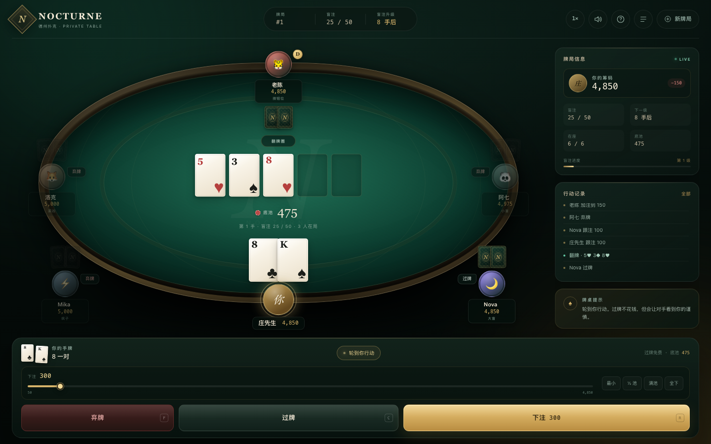
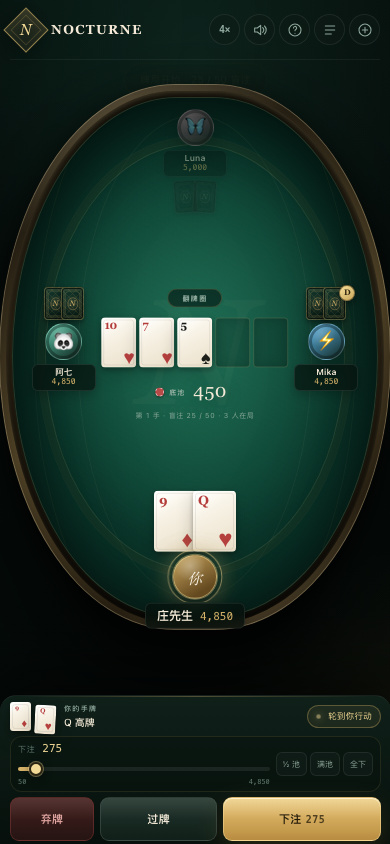
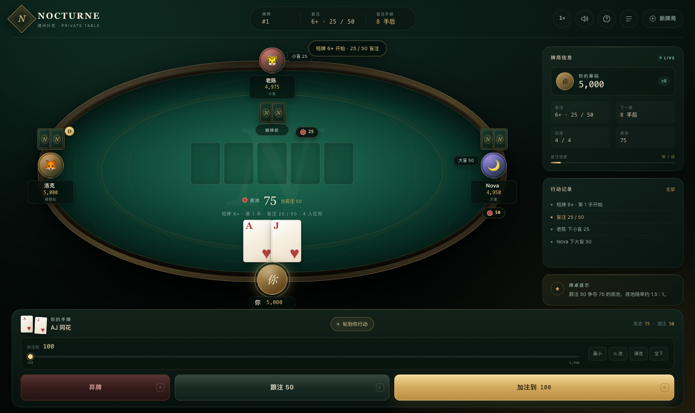
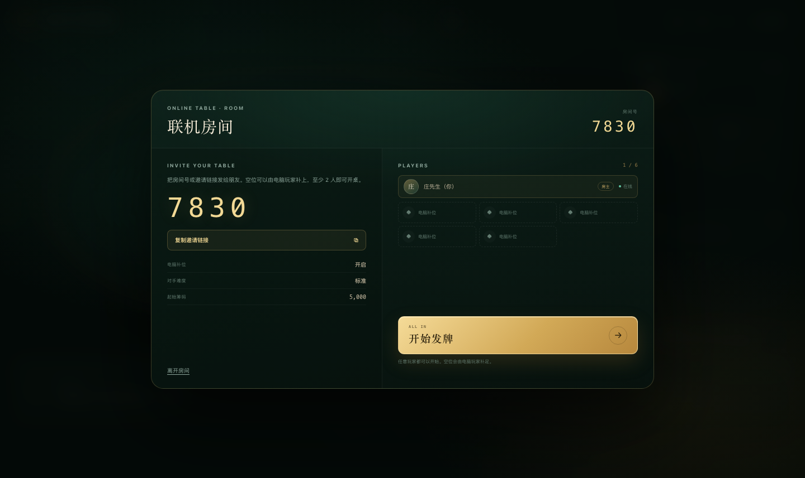
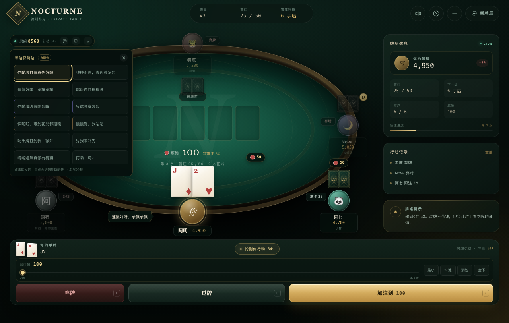
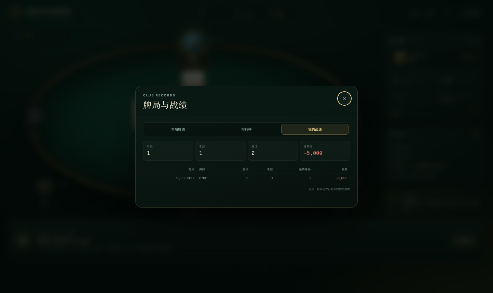
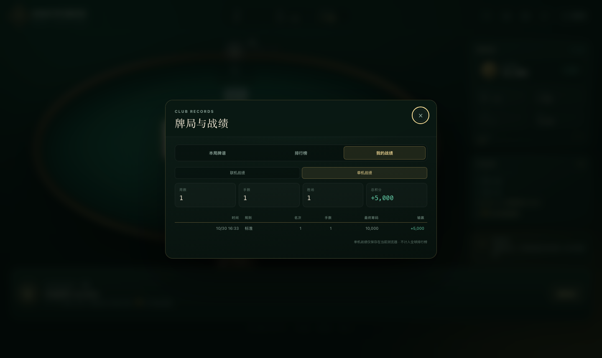

# NOCTURNE · 网页版德州扑克

**在线试玩：** [nocturne-holdem.onrender.com](https://nocturne-holdem.onrender.com)

一套完整的无上限德州扑克（No-Limit Texas Hold'em）：

- **单人模式**：纯静态，双击 `index.html` 就能和电脑玩家对战；
- **两种牌局**：标准 52 张德州，以及 **短牌 6+**（36 张、同花大于葫芦、A-6-7-8-9 最小顺子）；
- **牌桌音效**：发牌、翻牌、下注、跟注、加注、过牌、弃牌、全下、摊牌、轮到你、盲注升级、倒计时警告与胜负音效，全部由 Web Audio 实时合成，不依赖外部音频文件；
- **粤语快捷语**：12 句带粤语配音的牌桌快捷语，联机时一键发送，同桌会听到语音；服务端只接受白名单短语，1.5 秒冷却；
- **联机模式**：4 位房间号 / 邀请链接，真人同桌，空位由 AI 补足，支持断线重连、行动倒计时、隐藏底牌；
- **零框架、无构建步骤**：牌桌 UI、规则引擎、AI、联机服务全部使用原生 JavaScript / Node.js 实现；只有可选的持久化战绩使用 `pg`；
- **排行榜与历史战绩**：联机战绩按昵称聚合，单机战绩保存在本机浏览器；支持局数、手数、胜场、总积分和最近牌局记录。



<p align="center">
  
</p>

短牌 6+：



联机房间：



粤语快捷语：



排行榜与历史战绩：



联机 / 单机战绩切换：



---

## 快速开始

### 1. 只想单人玩

直接双击 `index.html`。项目使用经典 `<script>`，`file://` 协议下也能正常发牌。

macOS 也可以双击 `start.command`；如果本机没有 Node.js，它会自动退回单人静态模式。

### 2. 联机房间（推荐）

需要 Node.js 20+（仅联机服务器需要，玩家浏览器不需要安装任何东西）。

```bash
node server.js
# 打开 http://127.0.0.1:8787
```

或者：

```bash
npm start
```

启动后：

1. 选择「联机房间」；
2. 创建房间，把 4 位房间号或邀请链接发给朋友；
3. 朋友打开链接、输入昵称即可入座；
4. 任意玩家点击「开始发牌」，空位会按设置由电脑玩家补足；
5. 手机和电脑都可以直接玩。

### 3. 运行测试

```bash
npm test
```

33 个测试覆盖标准/短牌牌型、短牌 A-6-7-8-9 顺子、下注轮、最小加注、短码全下、边池、平分底池、盲注升级、AI 合法动作、筹码守恒，以及联机房间的创建、加入、隐私视图、短牌开局、离开转移房主、快捷语白名单/冷却/广播、语音文件 Range 请求和排行榜持久化。

---

## 联机模式怎么实现

`server.js` 是一个零框架的 Node HTTP 服务（仅在持久化战绩时使用 `pg`），同时做两件事：

1. 托管静态页面；
2. 托管联机牌局。

核心机制：

- 4 位房间号 + 随机 player token；
- 玩家浏览器通过 `EventSource`（SSE）接收房间状态，并带 1.5 秒轮询兜底（兼容会缓冲 SSE 的代理/隧道）；
- 玩家行动使用普通 `POST /api/act`；
- 服务端是唯一权威：发牌、规则、AI、结算全部在服务端运行；
- **每个玩家收到的状态都做了裁剪**：只包含自己的底牌、公共牌和已摊牌的牌，别人的底牌不会下发；
- 每个真人回合有 45 秒倒计时，超时自动过牌或弃牌；
- 玩家断线后保留座位，重新打开链接可凭本地 token 回到原座位；
- 所有真人离线时暂停牌局，有人回来再继续；
- 服务端内置 6 条 AI 性格与三档难度，空位自动补位。

房间数据保存在进程内存中，不需要数据库。进程重启后房间会清空。

### 联机 API 一览

```text
POST /api/create   创建房间（可选 variant: holdem | short）
POST /api/join     加入房间
POST /api/start    开始牌局
POST /api/act      提交行动
POST /api/chat     发送白名单快捷语
POST /api/check    校验 token / 重连
POST /api/leave    离开房间
GET  /api/events   SSE 实时状态
GET  /api/state    拉取当前视图（兜底）
GET  /api/leaderboard  排行榜
GET  /api/history      指定昵称的历史战绩
GET  /api/health   健康检查
```

### 排行榜数据

- 每场联机牌局结束时，按真人玩家记录：房间号、名次、买入、最终筹码、输赢、手数、是否夺冠；
- 排行榜按总积分排序，总积分 = 最终筹码 − 起始筹码；
- 联机历史战绩按昵称查询，最近 40 场；单机历史最多保留 100 场；
- **联机战绩**：配置 `DATABASE_URL` 时写入 Postgres 的 `nocturne_stats` 表；未配置时写入 `data/stats.json`。线上使用 **Neon 免费 Postgres**，跨 Render 重启/休眠保留；单机战绩不会进入这个表。
- **单机战绩**：保存在当前浏览器的 `localStorage`，按昵称查看；不上传服务器，也不计入全球排行榜。适合记录自己和电脑的对局。
- 打开「牌局与战绩 → 我的战绩」，可在 **联机战绩 / 单机战绩** 之间切换。

---

## 部署：不需要自己的服务器

### 方案 A：Render 免费 Web + Neon 免费 Postgres（推荐）

这个组合不需要为数据库付费，也不会遇到 Render 免费 Postgres 的 30 天删除：

1. 在 [Neon](https://neon.tech/) 创建一个免费项目，区域选 **Singapore / AWS ap-southeast-1**；
2. 复制数据库连接串（包含 `sslmode=require`）；
3. 在 [Render](https://render.com/) 用仓库里的 `render.yaml` 创建 Blueprint；
4. `render.yaml` 会提示填写 `DATABASE_URL`，粘贴 Neon 连接串即可；
5. 部署完成后得到 `https://xxx.onrender.com`，把链接发给朋友。

`render.yaml` 不创建 Render Postgres，只创建免费的 Node Web Service。Neon 免费层有存储/计算额度，数据跨 Render 重启和休眠保留。

> Render 免费实例长时间无人访问会休眠，第一次打开可能需要等几十秒；每月 750 免费实例小时。房间是内存数据，服务重启后会清空，排行榜在 Neon 里不受影响。

### 方案 B：Docker / 任意 Node 主机

```bash
docker build -t nocturne-holdem .
docker run -p 8787:8787 nocturne-holdem
```

或直接：

```bash
PORT=3000 node server.js
```

### 方案 C：纯静态托管（只有单人模式）

把整个文件夹拖到 Netlify Drop、GitHub Pages、Cloudflare Pages 等静态托管即可。页面检测不到 `/api/health` 时会自动禁用联机入口，只保留单人牌桌。

```text
Netlify Drop: https://app.netlify.com/drop
```

静态托管只支持单人模式；需要联机时请使用 Node/Render。

---

## 玩法

- 6 人桌淘汰赛，你 + 1–5 位电脑玩家，或真人 + 电脑混合；
- 入座时可切换 **标准德州 / 短牌 6+**，联机房间由房主选择，所有玩家共享同一规则。
- 起始筹码 2,000 / 5,000 / 10,000 可选，初始盲注 25 / 50，每 8 手升级一次。
- 完整流程：发底牌 → 翻牌前 → 翻牌 → 转牌 → 河牌 → 摊牌。
- 支持下注、加注、过牌、跟注、弃牌、全下、主池 / 边池、平分底池与奇数筹码分配。
- 筹码归零淘汰，最后留在桌上的玩家获胜。

### 短牌 6+ 规则

- 去掉 2、3、4、5，只用 36 张牌；
- 同花大于葫芦；顺子仍然大于三条（7 张牌短牌的主流排名）；
- A 可以组成 A-6-7-8-9 的最小顺子，也可以组成 A-K-Q-J-10 的最大顺子；
- 当前版本保留标准盲注/淘汰赛结构，没有改成赌场常见的“前注 + 按钮盲”结构。

### 操作

- 点击 `弃牌` / `过牌·跟注` / `加注·下注`。
- 加注区可用滑杆或 `最小 / ½ 池 / 满池 / 全下` 快捷金额。
- 键盘：`F` 弃牌，`C` 过牌 / 跟注，`R` 按当前金额加注，`Esc` 关闭弹窗。
- 右上角可开关声音、切换电脑速度、查看规则与完整牌局记录。
- 音效可随时用顶部声音按钮一键静音；联机时对手的行动、轮到你行动和最后 5 秒倒计时都有独立提示音。
- 联机牌桌左上角的快捷语按钮提供 12 句粤语短语，发送后同桌会看到气泡并听到粤语配音；服务端只接受内置短语，不能发送任意文本。
- 联机房间中，左上角房间胶囊显示房间号、连接状态和你的行动倒计时。

---

## 项目结构

```text
index.html                 页面结构
css/style.css              牌桌、卡牌、动效与响应式布局
js/cards.js                牌组、洗牌、格式化
js/evaluator.js            5–7 张牌最佳牌型评估
js/engine.js               无上限德州规则引擎（下注轮 / 边池 / 摊牌）
js/ai.js                   胜率模拟与电脑玩家策略
js/app.js                  界面渲染、单机流程、联机 UI、SSE 客户端与战绩弹窗
server.js                  零框架 Node 联机房间服务（静态托管 + API + SSE）
stats-store.js             排行榜/历史战绩存储（JSON 或 Postgres 快照）
tests/                     牌型、规则、AI、联机 API 与排行榜测试
render.yaml                Render 免费 Web + Neon 部署配置
Dockerfile                 容器部署
```

### 技术要点

- 52 张牌使用 `crypto.getRandomValues` 无偏洗牌。
- 牌型评估枚举 7 选 5，返回最佳五张、类别与踢脚。
- 下注轮完整处理：大盲选项、最小加注、短码全下的“不重开加注”、全下后自动发完公共牌。
- 边池按每位玩家的总投入分层结算，弃牌玩家的筹码留在底池中。
- 联机视图按观看者旋转座位，自己永远在下方；服务端裁剪底牌，前端只拿到可见信息。
- 联机操作带服务端合法性校验，客户端无法伪造牌或越权行动。
- 牌桌音效使用 Web Audio 振荡器与噪声实时合成，离线单机也能正常发声；12 段粤语快捷语配音是打包的 `.m4a` 音频（约 230 KB），仅在联机快捷语中使用，支持 HTTP Range 请求，移动端也能正常预载和播放。

---

## 已知边界

- 联机房间保存在进程内存中，服务重启或长时间无访问会丢失进行中的房间；排行榜和历史战绩保存在 Neon/本地文件，不受影响。
- 单机战绩只存在当前浏览器；换设备、清浏览器数据或换昵称后看不到旧记录，也不会出现在全球排行榜。
- 当前是单进程房间服务，不支持多实例/横向扩容；要做大规模公网服务，需要 Redis/Postgres 等共享状态和持久化。
- 线上使用 Render 免费 Web Service + Neon 免费 Postgres；Render 免费实例会休眠，Neon 免费层有存储/计算额度限制。
- 排行榜按昵称合并，没有账号/密码体系，因此改名或重名会合并统计；适合朋友之间娱乐，不适合作为严肃竞技积分。
- 短牌当前保留盲注结构，不是完整的赌场 6+ 前注规则；如果需要前注/按钮盲版本可以继续加。
- 没有接入真钱支付，也不适合真钱博彩。
- 静态托管只能单人；联机必须运行 `server.js` 或使用 Render/Docker 等 Node 环境。

## License

[MIT](LICENSE) © 2026 NOCTURNE Hold'em

调研过 [Tehes/poker](https://github.com/Tehes/poker)、[yusheng9511/texas_holdem](https://github.com/yusheng9511/texas_holdem)、[bocaletto-luca/Texas-Holdem](https://github.com/bocaletto-luca/Texas-Holdem) 等项目。最终规则引擎、AI、联机服务与界面均为本项目独立实现。
